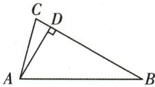
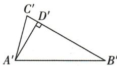
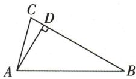
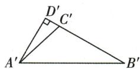
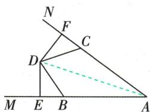
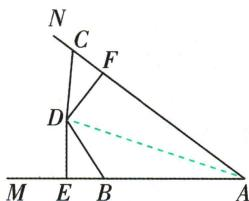

> [!success]- 必刷题
>
> > [!success] **【答案】** B
>
> > [!note]- **【解析】**
> > 如图(1)，图(2)所示，当 AD 在 $\triangle ABC$ 内部， $A'D'$ 在 $\triangle A'B'C'$ 内部时， $\because AC = A'C'$ ， $AD = A'D'$ ， $\therefore Rt\triangle ACD \cong \triangle Rt\triangle A'C'D'$ （HL）， $\therefore \angle C = \angle C' = n^{\circ}$ .
> >
> > 
> >
> > 
> > 图(1)
> > 图(2)
> >
> > 如图(3)，图(4)所示，当 $AD$ 在 $\triangle ABC$ 内部， $A'D'$ 在 $\triangle A'B'C'$ 外部时， $\because AC = A'C', AD = A'D'$ ， $\therefore Rt \triangle ACD \cong Rt \triangle A'C'D'(HL), \therefore \angle A'C'D' = \angle C = n^\circ, \therefore \angle A'C'B' = 180^\circ - n^\circ, \therefore$ 要把甲和丙的答案合在一起才完整. 故选 B.
> >
> > 
> >
> > 
> > 图(3)
> > 图(4)
> >
> > 3.6或10【解析】①如图(1)，当点 $C$ 在线段 $AF$ 上时，连接 $AD$ . $\because DE\perp AM$ 于 $E,DF\perp AN$ 于 $F,\therefore \angle DEB = \angle DFC = 90^{\circ}$ .在Rt△DEB和Rt△DFC中， $\left\{ \begin{array}{ll}DB = DC,\\ DE = DF, \end{array} \right.\therefore \mathrm{Rt}\triangle DEB\cong$ Rt△DFC（HL），∴ $CF = BE = 2$ 又∵在Rt△DEA和Rt△DFA中， $\left\{ \begin{array}{ll}DA = DA,\\ DE = DF, \end{array} \right.$ ∴ Rt△DEA≌Rt△DFA(HL)，∴ $AF = AE = AB+$ $BE = 6 + 2 = 8$ ，∴ $AC = AF - CF = 8 - 2 = 6$
> >
> > 
> >
> > 
> > 图(1)
> > 图(2)
> > - **②**：如图(2)，当点 C 在线段 AF 的延长线上时，连接 AD. 同①可得 AF = AE = 8, CF = BE = 2, $\therefore AC = AF + CF = 8 + 2 = 10$ . 故答案为 6 或 10.
