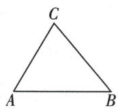
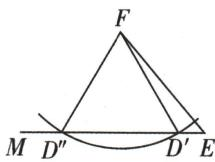
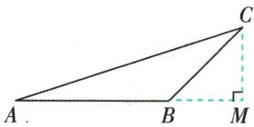
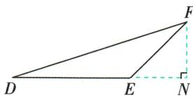

> [!success]- 必刷题
>
> > [!success] **【答案】** C
>
> > [!note]- **【解析】**
> > (1) HL
> >
> > (2)【解】如图(1)，以 F 为圆心，AC 长为半径画弧，交射线 EM 于 $D''$ ， $D'$ ，则 $D''F = D'F = AC$ ，易得 $\triangle D''EF \cong \triangle ABC$ ， $\triangle D'EF$ 和 $\triangle ABC$ 不全等，∴ $\triangle ABC$ 和 $\triangle DEF$ 不一定全等。故答案为 C.
> >
> > 
> >
> > 
> > 图(1)
> >
> > (3)【证明】如图(2)，过点 C 作 $CM \perp AB$ 交 AB 的延长线于点 M，过点 F 作 $FN \perp DE$ 交 DE 的延长线于点 N.
> >
> > 
> >
> > 
> > 图(2)
> >
> > 关键点拨
> > 证明 $\triangle BAC \cong \triangle EAD$ 是解题关键.
> >
> > ∵ CM⊥AB 于点 M, FN⊥DE 于点 N, ∴ ∠M = ∠N = 90°. ∵ ∠CBA = ∠FED, ∴ 180° - ∠CBA = 180° - ∠FED, 即 ∠CBM = ∠FEN. 在
> > △CBM 和 △FEN 中, $\left\{\begin{aligned}\angle CBM &= \angle FEN, \\ \angle M &= \angle N, \\ BC &= EF,\end{aligned}\right.$ ∴ △CBM ≅ △FEN (AAS), ∴ CM = FN. 在
> > Rt△ACM 和 Rt△DFN 中, $\left\{\begin{aligned}AC &= DF, \\ CM &= FN,\end{aligned}\right.$ ∴ Rt△ACM ≅ Rt△DFN (HL), ∴ ∠A = ∠D.
> > 在△ABC和△DEF中, $\left\{\begin{aligned}\angle A &= \angle D, \\ \angle CBA &= \angle FED, \\ AC &= DF,\end{aligned}\right.$
> >
> > $$
> > \therefore \triangle A B C \cong \triangle D E F (\mathrm{AAS})
> > $$
