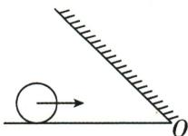
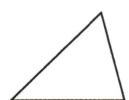
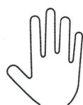

<!-- question-source:start -->
3 新考向跨学科综合 [2024 浙江绍兴期中]一平面镜与水平面成 $45^{\circ}$ 角并被固定在水平桌面上, 如图所示,一个小球以 1 cm/s 的速度沿桌面向点 O 匀速滚去,则小球在平面镜中的像是(平面镜所成的像与物体关于镜面对称) ( )

A. 以 1 cm/s 的速度,竖直向下运动

B. 以 1 cm/s 的速度,竖直向上运动

C. 以 2 cm/s 的速度运动,且运动路线与地面成 $45^{\circ}$ 角

D. 以 2 cm/s 的速度,竖直向下运动

(第3题图)

(第 4 题图)
<!-- question-source:end -->

![[Q00104206A1]]
