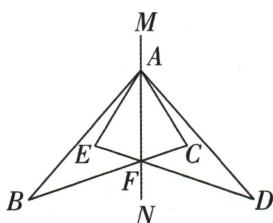

<!-- question-source:start -->
7[2024 陕西西安质检]如图, $\triangle ABC$ 和 $\triangle ADE$ 关于直线 MN 对称, BC 和 DE 的交点 F 在直线 MN 上.

(1)图中点 B 的对应点是点 \_\_\_\_； $\angle E$ 的对应角是 \_\_\_\_.

(2) 若 $ED = 9, BF = 6$ , 则 $EF$ 的长为 \_\_\_\_.

(3) 连接 $BD$ 和 $EC, BD$ 和 $EC$ 的位置关系为 \_\_\_\_.
<!-- question-source:end -->

![[Q00104210A1]]
