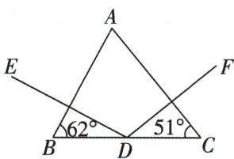
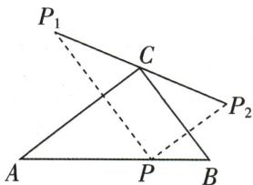

<!-- question-source:start -->
2[2024 辽宁本溪期中, 中]如图, $\triangle ABC$ 中, $D$ 点在 $BC$ 上, 分别以 $AB, AC$ 所在直线为对称轴, 画出点 $D$ 的对称点 $E, F$ , 并连接 $DE, DF$ . 根据图中标示的数据, 求得 $\angle EDF$ 的度数为 ( ) A. $113^{\circ}$ B. $124^{\circ}$ C. $102^{\circ}$ D. $134^{\circ}$

(第2题图)

(第3题图)
<!-- question-source:end -->

![[Q00104212A1]]
