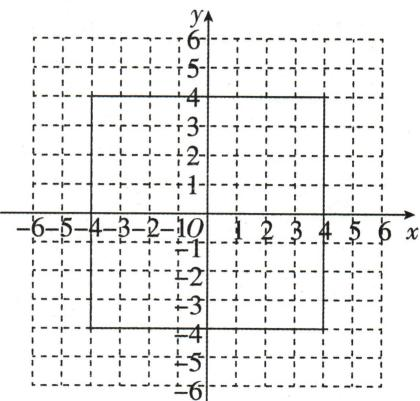

<!-- question-source:start -->
5 思想方法 数形结合 [2025 北京海淀区校级期中, 较难] 在平面直角坐标系 $xOy$ 中, 点 $P(a, b)$ 为图形 $G$ 上一点, 当 $|a| > |b|$ 时, 作点 $P$ 关于第一、三象限角平分线的对称点, 称为变换 1; 当 $|a| \leqslant |b|$ 时, 作点 $P$ 关于直线 $y = a$ 的对称点, 称为变换 2.

(1)①已知点A坐标为(2,1)，则点A作相应变换后的点的坐标为\_\_\_\_；

②若点 Q 作相应变换后的点的坐标为 $(-1, 2)$ ，求点 Q 的坐标.

(2)已知 $B(m,1)$ , $C(m,3)$ .

①若线段 BC 上所有的点通过变换 2 所得图形在 x 轴下方, 则 m 的取值范围是 \_\_\_\_;

②如图,已知边长为8的正方形中心为点O,且各边与坐标轴平行,若正方形内部(含边)同时存在线段BC上点的两种变换点,则m的取值范围是\_\_\_\_.

<!-- question-source:end -->

![[Q00104215A1]]
