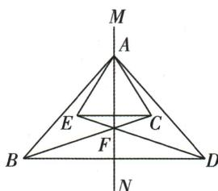

> [!success]- 必刷题
>
> > [!success] **【答案】** D
>
> > [!note]- **【解析】**
> > (1) 点 B 的对应点是点 D, $\angle E$ 的对应▶归纳总结
> >
> > 角是 $\angle C$ , 故答案为 D, $\angle C$ . 如果两个图形
> >
> > (2)∵由对称知DF=
> > BF = 6, ∴ EF = ED -
> > DF = 9 - 6 = 3.
> >
> > (3) 如图, ∵ 由对称可知 $MN \perp EC$ , $MN \perp DB$ , ∴ $EC \parallel BD$ .
> >
> > 
