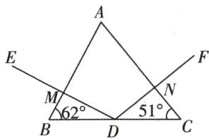
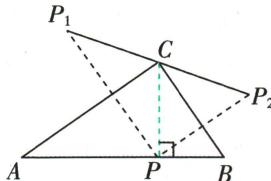

> [!success]- 必刷题
>
> > [!success] **【答案】** A
>
> > [!note]- **【解析】**
> > 如图, 设 AB 与 ED 交于点 M, AC 与 DF 交于点 N. ∵ 分别以 AB, AC 所在直线为对称
> >
> > 
> >
> > 轴, 画出点 $D$ 的对称点 $E, F, \therefore AB \perp ED, AC \perp DF$ , $\therefore \angle BMD = \angle DNC = 90^\circ$ . 在 Rt $\triangle BDM$ 中, $\angle ABD = 62^\circ$ , $\therefore \angle BDM = 90^\circ - \angle ABD = 90^\circ - 62^\circ = 28^\circ$ . 在 Rt $\triangle CDN$ 中, $\angle ACD = 51^\circ$ , $\therefore \angle CDN = 90^\circ - \angle ACD = 90^\circ - 51^\circ = 39^\circ$ , $\therefore \angle EDF = 180^\circ - \angle BDM - \angle CDN = 180^\circ - 28^\circ - 39^\circ = 113^\circ$ . 故选 A.
> >
> > 3.9.6
> >
> > 思路分析 | 利用轴对称的性质解决最值问题
> > 连接CP.点P关于直线AC，
> > BC对称的点分别为 $P_{1}$ ， $P_{2}$ $CP_{1}=CP=CP_{2}$ ; $\angle P_{1}CA=\angle PCA, \angle P_{2}CB=\angle PCB$ $P_{1}, C, P_{2}$ 三点共线 $P_{1}P_{2}=2CP$ ，求CP的最小值
> > 由垂线段最短，转化为求AB边上的高
> > 利用 $S_{Rt\triangle ABC}=\frac{1}{2}AB\cdot CP=\frac{1}{2}AC\cdot BC$ 且 AB=10, AC=8, BC=6
> >
> > 【解析】如图, 连接 CP. ∵ 点 P 关于直线 AC,
> >
> > BC 对称的点分别为 $P_{1}, P_{2}, \therefore P_{1}C = PC =$ $P_{2}C, \angle P_{1}CA = \angle PCA,$ $\angle P_{2}CB = \angle PCB,$
> >
> > 
> >
> > $\therefore \angle P_{1}CP_{2} = 2\angle ACB = 180^{\circ},\therefore P_{1},C,P_{2}$ 三点共线， $\therefore P_1P_2 = 2CP.$ 当 $CP\bot AB$ 时， $CP$ 的长最小，此时线段 $P_{1}P_{2}$ 的长最小. $\because \angle ACB =$ $90^{\circ},BC = 6,AC = 8,AB = 10,\therefore CP = \frac{AC\times BC}{AB} =$ 4.8，∴线段 $P_{1}P_{2}$ 的长的最小值是9.6.
