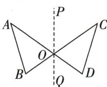
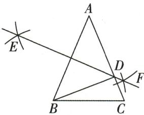

<!-- question-source:start -->
2[2024 河北中考]如图, AD 与 BC 交于点 O, △ABO 和 △CDO 关于直线 PQ 对称, 点 A, B 的对称点分别是点 C, D. 下列不一定正确的是 ( )
A. $AD \perp BC$ B. $AC \perp PQ$ C. $\triangle ABO \cong \triangle CDO$ D. AC // BD

(第2题图)

(第3题图)
<!-- question-source:end -->

![[Q00104317A1]]
