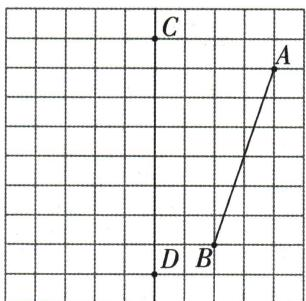

<!-- question-source:start -->
5[2023安徽中考]如图,在由边长为1个单位长度的小正方形组成的网格中,点A,B,C,D均为

建议用时-30分钟 答案-D52

格点(网格线的交点).

(1)画出线段 $AB$ 关于直线 $CD$ 对称的线段 $A_{1}B_{1}$ ;

(2) 将线段 AB 向左平移 2 个单位长度, 再向上平移 1 个单位长度, 得到线段 $A_{2}B_{2}$ , 画出线段 $A_{2}B_{2}$ ;

(3) 描出线段 $AB$ 上的点 $M$ 及直线 $CD$ 上的点 $N$ , 使得直线 $MN$ 垂直平分 $AB$ .

<!-- question-source:end -->

![[Q00104320A1]]
