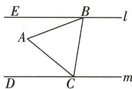

<!-- question-source:start -->
6[2024 山东泰安中考]如图, 直线 $l \parallel m$ , 等边三角形 ABC 的两个顶点 B, C 分别落在直线 l, m 上, 若 $\angle ABE = 21^{\circ}$ , 则 $\angle ACD$ 的度数是 ( )

A. $45^{\circ}$ B. $39^{\circ}$ C. $29^{\circ}$ D. $21^{\circ}$
<!-- question-source:end -->

![[Q00104321A1]]
