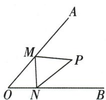

<!-- question-source:start -->
8[2024 黑龙江绥化中考]如图, 已知 $\angle AOB = 50^{\circ}$ , 点 P 为 $\angle AOB$ 内部一点, 点 M 为射线 OA、点 N 为射线 OB 上的两个动点, 当 $\triangle PMN$ 的周长最小时, 则 $\angle MPN =$ \_\_\_\_.

<!-- question-source:end -->

![[Q00104323A1]]
