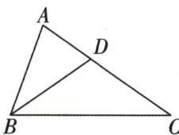

<!-- question-source:start -->
3[2025 黑龙江哈尔滨质检] 如图, 在 $\triangle ABC$ 中, $\angle BAC = 75^{\circ}$ , $\angle ACB = 35^{\circ}$ , $AC = 8$ , $\angle ABC$ 的平分线 $BD$ 交边 $AC$ 于点 $D$ , 则 $AD + BD$ 的长为 A.10 B.8 C.6

AC 于点 D, 则 AD+BD 的长为 ( )
A. 10    B. 8    C. 6    D. 4
<!-- question-source:end -->

![[Q00104326A1]]
