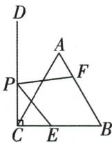
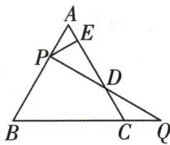

<!-- question-source:start -->
6[2024 江苏盐城期中]如图, 点 E 在等边 $\triangle ABC$ 的边 BC 上, BE=4, 射线 $CD \perp BC$ , 垂足为点 C,点 $P$ 是射线 $CD$ 上一动点，点 $F$ 是线段 $AB$ 上一动点，当 $EP + FP$ 的值最小时， $BF = 5$ ，则 $AF$ 的长为 （）A.1.5 B.2 C.2.5 D.3

(第6题图)

(第7题图)
<!-- question-source:end -->

![[Q00104328A1]]
