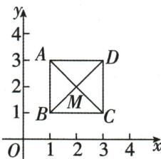
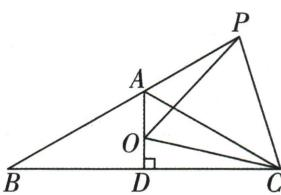

<!-- question-source:start -->
8 如图, 已知正方形 ABCD 的对角线 AC, BD 相交于点 M, 顶点 A, B, C 的坐标分别为 (1,3), (1,1), (3,1), 规定“把正方形 ABCD 先沿 x 轴翻折, 再向右平移 1 个单位”为一次变换, 如此这样, 连续经过 2020 次变换后, 点 M 的坐标变为
( )
A. (2022,2)    B. (2022,-2)
C. (2020,2)    D. (2020,-2)

(第8题图)

(第9题图)
<!-- question-source:end -->

![[Q00104330A1]]
