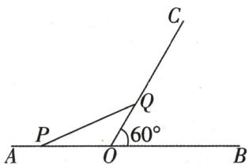

<!-- question-source:start -->
13 如图, $\angle BOC = 60^{\circ}$ , 点 $A$ 是 $OB$ 反向延长线上的一点, $OA = 10 \mathrm{~cm}$ , 动点 $P$ 从点 $A$ 出发沿 $AB$ 以 $2 \mathrm{~cm} / \mathrm{s}$ 的速度移动, 动点 $Q$ 从点 $O$ 出发沿 $OC$ 以 $1 \mathrm{~cm} / \mathrm{s}$ 的速度移动, 如果 $P, Q$ 同时出发, 用 $t \mathrm{~s}$ 表示移动的时间, 当 $t =$ \_\_\_\_时, $\triangle POQ$ 是等腰三角形.

<!-- question-source:end -->

![[Q00104335A1]]
