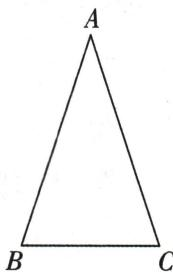

<!-- question-source:start -->
14[2025 山西吕梁期中]如图,在 $\triangle ABC$ 中, $AB=AC,\angle A=36^{\circ}$ .

(1)尺规作图:作线段AB的垂直平分线,交AB于点E,交AC于点D,连接BD.(不必写作图步骤,保留作图痕迹)

(2) 求证: $BD = BC$ .

<!-- question-source:end -->

![[Q00104336A1]]
