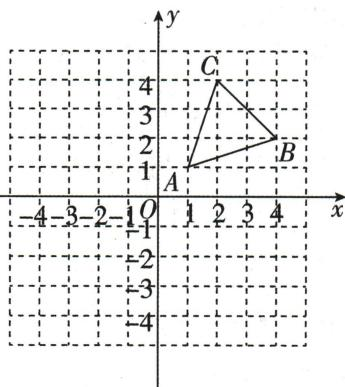

<!-- question-source:start -->
15[2025 江苏无锡质检]在如图所示的由小正方形组成的网格中建立平面直角坐标系,已知 $\triangle ABC$ 的顶点都在小正方形的顶点上.

(1) $\triangle ABC$ 三个顶点的坐标分别为 $A$ \_\_\_\_, $B$ \_\_\_\_, $C$ \_\_\_\_.

(2)借助网格,请只用直尺(不含刻度)在x轴上找一点Q,使得 $\triangle QAB$ 的周长最小(在图中标出点Q),此时点Q的坐标为\_\_\_\_.
<!-- question-source:end -->

![[Q00104337A1]]
