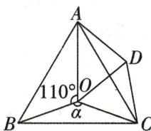

<!-- question-source:start -->
16[2024 辽宁丹东期末]如图, 点 O 是等边 $\triangle ABC$ 内一点, D 是 $\triangle ABC$ 外的一点, $\angle AOB = 110^{\circ}$ , $\angle BOC = \alpha$ , $\triangle BOC \cong \triangle ADC$ , $\angle OCD = 60^{\circ}$ , 连接 OD.

(1) 求证: $\triangle OCD$ 是等边三角形.

(2) 当 $\alpha = 150^{\circ}$ 时, 试判断 $\triangle AOD$ 的形状, 并说明理由.

(3) 探究: 当 $\alpha$ 为多少度时, $\triangle AOD$ 是等腰三角形?

<!-- question-source:end -->

![[Q00104338A1]]
