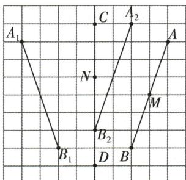

> [!success]- 必刷题
>
> > [!success] **【答案】** 详见解析
>
> > [!note]- **【解析】**
> > 【解】(1)如图所示,线段 $A_{1}B_{1}$ 即为所求.
> > (2)如图所示,线段 $A_{2}B_{2}$ 即为所求.
> > (3)如图所示,点M,N即为所求.
> >
> > 关于 y 轴对称的点的坐标特征: 横坐标互为相反数, 纵坐标不变.
> >
> > 
