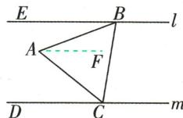

> [!success]- 必刷题
>
> > [!success] **【答案】** B
>
> > [!note]- **【解析】**
> > 如图, 过点 A 作 $AF \parallel l$ . ∵ 直线 $l \parallel m$ , ∴ $AF \parallel m$ . ∵ $\triangle ABC$ 是等边三角形, ∴ $\angle BAC = 60^{\circ}$ . ∵ $AF \parallel l$ , ∴ $\angle BAF = \angle ABE$ . ∵ $\angle ABE = 21^{\circ}$ , ∴ $\angle BAF = 21^{\circ}$ , ∴ $\angle CAF = \angle BAC - \angle BAF = 60^{\circ} - 21^{\circ} = 39^{\circ}$ . ∵ $AF \parallel m$ ,$\therefore \angle ACD = \angle CAF = 39^{\circ}$ ，故选 B.
> >
> > 
