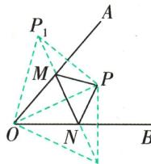

> [!success]- 必刷题
>
> > [!success] **【答案】** $80^{\circ}$
>
> > [!note]- **【解析】**
> > 如图,作 P 关于 OA, OB 的对称点 $P_{1}, P_{2}$ , 连接 $OP_{1}, OP_{2}, P_{1}P_{2}, OP, P_{1}P_{2}$ 分别
> >
> > 交 $OA, OB$ 于点 $M, N$ , 此时 $\triangle PMN$ 的周长最小. $\because P, P_1$ 关于 $OA$ 对称, $\therefore \angle P_1OP = 2\angle MOP, OP_1 = OP, P_1M = PM, \angle OP_1M = \angle OPM$ . 同理, $\angle P_2OP = 2\angle NOP, OP =$
> >
> > 
> > $P_{2}$
> >
> > $OP_{2}, \angle OP_{2}N = \angle OPN, \therefore \angle P_{1}OP_{2} = \angle P_{1}OP + \angle P_{2}OP = 2 (\angle MOP + \angle NOP) = 2 \angle AOB = 100^{\circ}, OP_{1} = OP_{2} = OP, \therefore \triangle P_{1}OP_{2}$ 是等腰三角形，∴ $\angle OP_{2}N = \angle OP_{1}M = 40^{\circ}, \therefore \angle MPN = \angle MPO + \angle NPO = \angle OP_{1}M + \angle OP_{2}N = 80^{\circ}$ . 故答案为 $80^{\circ}$ .
