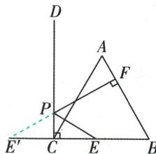
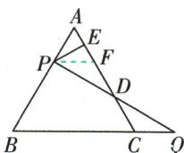

> [!success]- 必刷题
>
> > [!success] **【答案】** B
>
> > [!note]- **【解析】**
> > 如图,作 E 点关于 CD 的对称点 $E'$ , 过 $E'$ 作 $E'F \perp AB$ 于点 F, 交 CD 于点 P, 连接 PE, 则 $PE = PE'$ , ∴ $EP + FP = PE' + PF = E'F$ ,
> >
> > 此时 $EP + FP$ 的值最小. $\because \triangle ABC$ 是等边三角形， $\therefore \angle B = 60^{\circ}.\because E^{\prime}F\perp AB,$ $\therefore \angle FE^{\prime}B = 30^{\circ},\therefore BE^{\prime} =$ $2BF = 2\times 5 = 10.\because BE = 4,$
> >
> > 
> >
> > $CE=CE',\therefore 10=2CE+BE=2CE+4,\therefore CE=3,$ ∴ BC = BE + CE = 4 + 3 = 7, ∴ AB = BC = 7,
> > ∴ AF = AB - BF = 7 - 5 = 2, 故选 B.
> >
> > $$
> > \therefore \angle Q = \angle F P D. \because \triangle A B C
> > $$
> >
> > $$
> > P F \parallel B C
> > $$
> >
> > 
> >
> > $$
> > \therefore \angle A P F = \angle B = 6 0 ^ {\circ}, \angle A F P = \angle A C B = 6 0 ^ {\circ}
> > $$
> >
> > $\therefore \triangle APF$ 是等边三角形, $\therefore AP = PF.\because AP = CQ,\therefore PF = CQ.$ 在 $\triangle PFD$ 和 $\triangle QCD$ 中, $\left\{ \begin{array}{l}\angle FPD = \angle Q,\\ \angle PDF = \angle QDC,\therefore \triangle PFD\cong \triangle QCD(AAS),\\ PF = CQ, \end{array} \right.$ $\therefore FD = CD.\because PE\perp AC$ 于 $E,\triangle APF$ 是等边三角形, $\therefore AE = EF,\therefore AE + DC = EF + FD,\therefore DE = \frac{1}{2} AC.\because AC = 4,\therefore DE = 2.$
> >
> > 故选 **A**.
