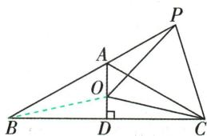
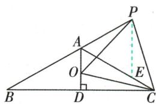
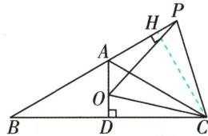

> [!success]- 必刷题
>
> > [!success] **【答案】** D
>
> > [!note]- **【解析】**
> > 如图(1)，连接 OB. ∵ ∠BAC = 120°, AB = AC, AD ⊥ BC, ∴ ∠ABC = ∠ACB = 30°, BD = CD, ∠BAD = ∠CAD = $\frac{1}{2}$ ∠BAC = $\frac{1}{2}$ × 120° = 60°, ∴ AD 垂直平分 BC, ∴ OB = OC.
> >
> > ∵ OP = OC, ∴ OB = OC = OP, ∴ ∠APO = ∠ABO, ∠DCO = ∠DBO, ∴ ∠APO + ∠DCO = ∠ABO + ∠DBO = ∠ABD = 30°，故①正确.
> >
> > ∵ ∠APC + ∠DCP + ∠PBC = 180°, ∴ ∠APC + ∠DCP = 150°.
> >
> > ∵ ∠APO + ∠DCO = 30°,
> >
> > ∴ ∠OPC + ∠OCP = 120°, ∴ ∠POC = 180° - (∠OPC + ∠OCP) = 60°.
> >
> > ∵ OP = OC, ∴ △OPC 是等边三角形，故②正确.
> >
> > ∵ △OPC 是等边三角形，∴ OP = OC = PC, ∠OPC = 60°.
> >
> > 
> >
> > 
> > 图(1)
> > 图(2)
> >
> > 如图(2)，在 $AC$ 上截取 $AE = PA$ . $\because \angle PAE = 180^{\circ} - \angle BAC = 60^{\circ}$ , $\therefore \triangle APE$ 是等边三角形, $\therefore \angle PEA = \angle APE = 60^{\circ}, PE = PA, \therefore \angle APO + \angle OPE = 60^{\circ}$ . $\because \angle OPE + \angle CPE = \angle CPO =$
> >
> > $60^{\circ}, \therefore \angle APO = \angle CPE.$ 在 $\triangle OPA$ 和 $\triangle CPE$ 中， $\left\{ \begin{array}{l} PA = PE, \\ \angle APO = \angle EPC, \therefore \triangle OPA \cong \triangle CPE \\ OP = CP, \end{array} \right.$ (SAS), $\therefore AO = CE, \therefore AC = CE + AE = AO + AP,$ 故③正确. 如图(3)，过点 $C$ 作 $CH \perp AP$ 于 $H$ . $\because \angle PAC =$
> >
> > $\angle DAC = 60^{\circ}, AD \perp BC,$ $\therefore CH = CD.\because S_{\triangle ABC} =$ $\frac{1}{2} AB\cdot CH,S_{\text{四边形} A O C P} =$ $S_{\triangle A C P} + S_{\triangle A O C} = \frac{1}{2} AP\cdot$ 易错警示
> > 当 $\triangle POQ$ 是等腰三角形时, 需分情况讨论:
> >
> > 
> > 图(3)
> > - **①**：当点 P 在 OA 上时，
> > PO=OQ;
> > - **②**：当点 P 在 OB 上时，
> > PO=OQ.
> >
> > $CH+\frac{1}{2}OA\cdot CD=\frac{1}{2}AP\cdot CH+\frac{1}{2}OA\cdot CH=$ $\frac{1}{2}CH\cdot(AP+OA)=\frac{1}{2}CH\cdot AC=\frac{1}{2}CH\cdot AB,$ ∴ $S_{\triangle ABC}=S_{四边形AOCP}$ ，故④正确.
> >
> > 故选 **D**.
