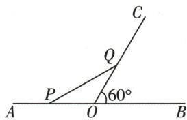
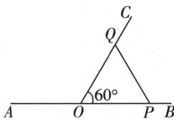

> [!success]- 必刷题
>
> > [!success] **【答案】** $\frac{10}{3}$ 或 10
>
> > [!note]- **【解析】**
> > 当 $P$ 在 $OA$ 上, $PO = QO$ 时, $\triangle POQ$ 是等腰三角形, 如图 (1) 所示. $\because PO = AO - AP = (10 - 2t)\mathrm{cm}, OQ = t\mathrm{cm}, \therefore$ 当 $PO = QO$ 时, $10 - 2t = t$ , 解得 $t = \frac{10}{3}$ . 当 $P$ 在 $OB$ 上, $PO = QO$ 时, $\triangle POQ$ 是等腰三角形, 如图 (2) 所示. $\because PO = AP - AO = (2t - 10)\mathrm{cm}, OQ = t\mathrm{cm}, \therefore$ 当 $PO = QO$ 时, $2t - 10 = t$ , 解得 $t = 10$ .
> >
> > 故当 $t = \frac{10}{3}$ 或10时， $\triangle POQ$ 是等腰三角形
> >
> > 
> > 图(1)
> >
> > 
