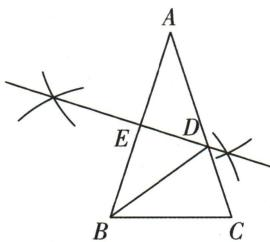

> [!success]- 必刷题
>
> > [!success] **【答案】** (1)【解】如图. 图(2)  (2)
>
> > [!note]- **【解析】**
> > 【证明】∵ AB = AC, ∠A = 36°, ∴ ∠ABC = ∠C = $\frac{1}{2}$ (180° - ∠A) = 72°. ∵ DE 是 AB 的垂直平分线, ∴ AD = BD, ∴ ∠ABD = ∠A = 36°, ∴ ∠BDC = ∠A + ∠ABD = 36° + 36° = 72° = ∠C, ∴ BD = BC.
