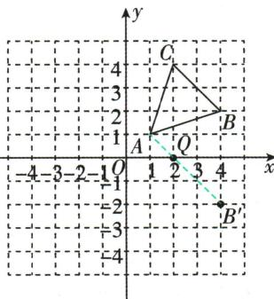

> [!success]- 必刷题
>
> > [!success] **【答案】** $(1,1),(4,2),(2,4)$ (2)如图，作点 $B$ 关于 $x$ 轴对称的点 $B^{\prime}$ ，连接 $AB^{\prime}$ ，交 $x$ 轴于 $Q$ ，则点 $Q$ 即为所求，点 $Q$ 的坐标为(2,0)
>
> > [!note]- **【解析】**
> > 【解】(1)根据题图得 $A(1,1),B(4,2),C(2,$ 4)，故答案为 $(1,1),(4,2),(2,4)$ (2)如图，作点 $B$ 关于 $x$ 轴对称的点 $B^{\prime}$ ，连接 $AB^{\prime}$ ，交 $x$ 轴于 $Q$ ，则点 $Q$ 即为所求，点 $Q$ 的坐标为(2,0).故答案为(2,0).
> >
> > 
