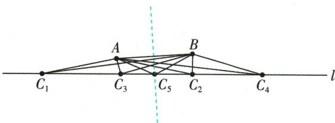

> [!success]- 必刷题
>
> > [!success] **【答案】** A
>
> > [!note]- **【解析】**
> > 如图, 点 $C_{1}, C_{2}, C_{3}, C_{4}, C_{5}$ 即为符合条件的点 C, 故选 A.
> >
> > 
> >
> > 归纳总结
> > 需分别按 AB = AC, AC = BC, AB = BC 三种情形画出图形，其中当 AC = BC 时，C 在 AB 的垂直平分线与直线 l 的交点处.
