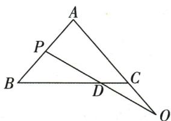
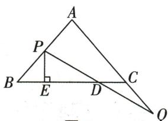

<!-- question-source:start -->
1[2024 山东菏泽调研,较难]如图,在 $\triangle ABC$ 中, $AB=AC$ ,点 $P$ 从点 $B$ 出发沿线段 $BA$ 移动,同时,点 $Q$ 从点 $C$ 出发沿线段 $AC$ 的延长线移动,当点 $P$ 到达点 $A$ 时,两点同时停止移动.已知点 $P,Q$ 移动的速度相同, $PQ$ 与直线 $BC$ 相交于点 $D$ .

(1)如图(1)，当点 $P$ 为 $AB$ 的中点时，试说明： $PD = QD$ .

(2)如图(2),过点P作直线BC的垂线,垂足为E,点P,Q在移动的过程中,线段BE,DE,CD中是否存在长度保持不变的线段?请说明理由.

图(1)

图(2)
<!-- question-source:end -->

![[Q00104304A1]]
