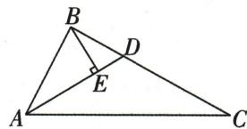

<!-- question-source:start -->
3[2025 河南郑州质检, 中]如图, 在 $\triangle ABC$ 中, $\angle ABC = 3\angle C, AD$ 平分 $\angle BAC, BE \perp AD$ 于 $E$ , 求证: $BE = \frac{1}{2}(AC - AB)$ . (提示: 延长 $BE$ 交 $AC$ 于点 $F$ ).

<!-- question-source:end -->

![[Q00104306A1]]
