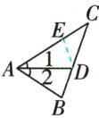
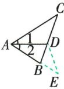
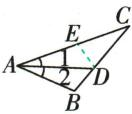
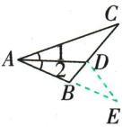

> [!success]- 必刷题
>
> > [!success] **【答案】** 详见解析
>
> > [!note]- **【解析】**
> > 【解】(1) 过 $P$ 点作 $PF \parallel AC$ 交 $BC$ 于 $F$ , 如
> >
> > ## 大招解读 | 截长补短
> >
> > <table><tr><td></td><td>截长法</td><td>补短法</td><td>截长法</td><td>补短法</td></tr><tr><td>模型展示</td><td></td><td></td><td></td><td></td></tr><tr><td>条件</td><td colspan="2"> $\angle 1 = \angle 2, \angle ABC = 2\angle C$ </td><td colspan="2"> $\angle 1 = \angle 2, \angle ABC = 90^{\circ} + \frac{1}{2}\angle C$ </td></tr><tr><td>方法</td><td>在AC上截取AE=AB</td><td>延长AB至点E,使BE=BD</td><td>在AC上截取AE=AB</td><td>延长AB至点E,使AE=AC</td></tr><tr><td>结论</td><td colspan="2"> $AC=AB+BD$ </td><td colspan="2"> $AC=AB+CD$ </td></tr></table>
