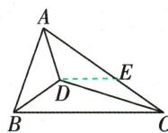
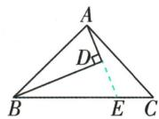

> [!success]- 必刷题
>
> > [!success] **【答案】** 详见解析
>
> > [!note]- **【解析】**
> > 【证明】如图,在 AC 上截取 AE,使 AE=AB,连接 DE,则 $AC=AB+CE=AE+CE=AB+BD,\therefore CE=BD.\because AD,BD,$
> >
> > 
> >
> > CD 分别平分 $\angle BAC, \angle ABC, \angle ACB,$ $\therefore \angle DAB = \angle DAE, \angle ABC = 2\angle ABD, \angle ACB = 2\angle ACD.$ 又 $\because AD = AD, \therefore \triangle ABD \cong \triangle AED,$ $\therefore BD = DE, \angle ABD = \angle AED, \therefore DE = CE,$ $\therefore \angle EDC = \angle ECD, \therefore \angle ABD = \angle AED = \angle EDC+$ $\angle ECD = 2\angle ECD = \angle ACB, \therefore \angle ABC = 2\angle ACB.$
> >
> > 条件: $\triangle ABC$ 中, BD 平分 $\angle ABC, AD \perp BD$ .
> > 辅助线:延长AD交BC于点E.
> > 结论:(1) $\triangle ABD\cong\triangle EBD.$ (2)AD=DE.
> > (3)BA=BE.
> >
> > 
> >
> > 关键点拨
> > 利用等量代换
> > 及等式的性质
> > 得出 $\angle CBF = \angle C$ 是解题
> > 关键.
