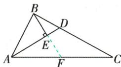

> [!success]- 必刷题
>
> > [!success] **【答案】** 详见解析
>
> > [!note]- **【解析】**
> > 【证明】如图,延长BE交AC于点F.∵BF⊥AD,∴∠AEB=∠AEF=90°.∵AD平分∠BAC,∴∠BAE=∠FAE.
> >
> > 
> >
> > 在 $\triangle ABE$ 和 $\triangle AFE$ 中， $\left\{ \begin{array}{l} \angle AEB = \angle AEF, \\ AE = AE, \\ \angle BAE = \angle FAE, \end{array} \right.$ $\therefore \triangle ABE \cong \triangle AFE(\mathrm{ASA}), \therefore \angle ABF = \angle AFB,$ $AB = AF, BE = EF. \because \angle C + \angle CBF = \angle AFB = \angle ABF, \angle ABF + \angle CBF = \angle ABC = 3 \angle C,$ $\therefore \angle C + 2\angle CBF = 3 \angle C, \therefore \angle CBF = \angle C,$ $\therefore BF = CF, \therefore BE = \frac{1}{2} BF = \frac{1}{2} CF. \because CF = AC - AF = AC - AB, \therefore BE = \frac{1}{2}(AC - AB).$
> >
> > 思路分析
> > (2)由等腰三角形的性质可得 AD 是 $\angle BAC$ 的平分线, 由角平分线的性质可得 DE = DF, 再通过等面积法即可求得 CG = 2DE.
