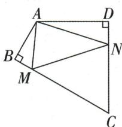

<!-- question-source:start -->
2[2024 山东青岛调研, 中]如图, 四边形 ABCD 中, $\angle BAD = 120^{\circ}$ , $\angle B = \angle D = 90^{\circ}$ , 在 BC, CD 上分别找一点 M, N, 使 $\triangle AMN$ 的周长最小, 则此时 $\angle AMN + \angle ANM$ 的度数为 ( )

A. $130^{\circ}$ B. $120^{\circ}$ C. $110^{\circ}$ D. $100^{\circ}$
<!-- question-source:end -->

![[Q00104311A1]]
