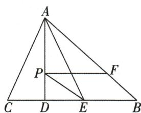

<!-- question-source:start -->
3 AI DPSK 原创 [中] 如图, 在 $\triangle ABC$ 中, $AD \perp BC$ , $AC = AE$ , $AD = 8$ , $BC = 18$ , 点 $P$ 为线段 $AD$ 上一动点, 点 $E$ 是 $BC$ 上一定点, 点 $F$ 是线段 $AB$ 上一动点, 则当 $EP + FP$ 取最小值 6 时, $AB$ 的长为 \_\_\_\_.

<!-- question-source:end -->

![[Q00104312A1]]
