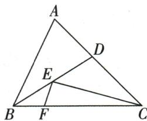

<!-- question-source:start -->
4[2024 安徽芜湖弋江区期末, 中]如图, 在锐角三角形 ABC 中, AB = 6, $\triangle ABC$ 的面积为 18, BD 平分 $\angle ABC$ , 若 E, F 分别是 BD, BC 上的动点, 则 CE + EF 的最小值为 ( )

A. 5 B. 6 C. 7 D. 8
<!-- question-source:end -->

![[Q00104313A1]]
