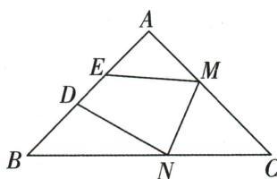

<!-- question-source:start -->
5[2024 北京西城区期末, 中]如图, 在 $\triangle ABC$ 中, $AB = AC$ , $\angle A = 90^{\circ}$ , 点 $D, E$ 是边 $AB$ 上的两个定点, 点 $M, N$ 分别是边 $AC, BC$ 上的两个动点. 当四边形 $DEMN$ 的周长最小时, $\angle DNM + \angle EMN$ 的度数是 ( )

A. $45^{\circ}$ B. $90^{\circ}$ C. $75^{\circ}$ D. $135^{\circ}$
<!-- question-source:end -->

![[Q00104314A1]]
