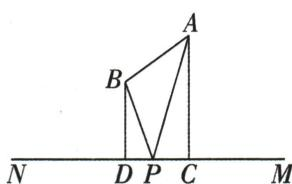

<!-- question-source:start -->
6[2024 山东泰安校级质检, 中]如图, A, B 两点都在直线 MN 的上方, AB = 5, A 到直线 MN 的距离 AC = 8, B 到直线 MN 的距离 BD = 5, P 在直线 MN 上运动, 则 | PA - PB | 的最大值等于 \_\_\_\_.

是个新“烤”鸭
<!-- question-source:end -->

![[Q00104315A1]]
