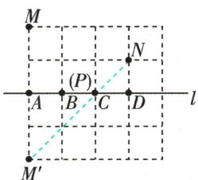
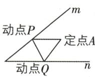
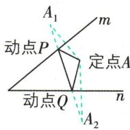

> [!success]- 必刷题
>
> > [!success] **【答案】** C
>
> > [!note]- **【解析】**
> > 如图, 点 $M'$ 是点 M 关于直线 l 的对称点, 连接 $M'N$ , 则 $M'N$ 与直线 l 的交点, 即为点 P, 此时 $PM + PN$ 的值最小. 因为 $M'N$ 与直线 l 交于点 C, 所以点 P 应选在 C 点. 故选 C.
> >
> > 
> >
> > ## 关键点拨
> >
> > 首先找到其中一点关于直线l的对称点，对称点与另一点的连线与直线l的交点就是所要找的点.
> >
> > ## 大招解读 | 两动一定（有去有回）
> >
> > 条件:如图(1),点A为定点,点Q在直线n上运动,点P在直线m上运动,求 $\triangle PAQ$ 周长的最小值.
> >
> > 
> > 图(1)
> >
> > 
> > 图(2)
> >
> > 方法:如图(2),分别作点A关于直线m,n的对称点 $A_{1},A_{2}$ ,连接 $A_{1}A_{2},A_{1}A_{2}$ 与直线m的交点即为点P,与直线n的交点即为点Q,此时 $\triangle PAQ$ 的周长有最小值,为 $PA+QA+PQ=PA_{1}+QA_{2}+PQ=A_{1}A_{2}$ .
