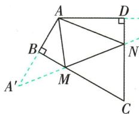
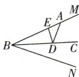
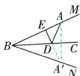
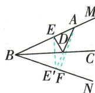
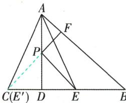

> [!success]- 必刷题
>
> > [!success] **【答案】** B
>
> > [!note]- **【解析】**
> > 如图, 分别作 A 关于直线 BC 和 CD 的对称点 $A', A''$ , 连接 $A'A''$ , 交 BC 于 M, 交
> >
> > CD 于 N, 则易得 $A^{\prime}A^{\prime\prime}$ 的长即为 $\triangle AMN$ 周长的最小值. 因为 $\angle DAB = 120^{\circ}$ ,
> >
> > 
> >
> > 所以 $\angle A' + \angle A'' = 180^\circ - \angle DAB = 60^\circ$ . 因为 $\angle A' = \angle MAA'$ , $\angle NAD = \angle A''$ , 且 $\angle A' + \angle MAA' = 180^\circ - \angle AMA' = \angle AMN$ , $\angle NAD + \angle A'' = 180^\circ - \angle ANA'' = \angle ANM$ , 所以 $\angle AMN + \angle ANM = \angle A' + \angle MAA' + \angle NAD + \angle A'' = 2 (\angle A' + \angle A'') = 2 \times 60^\circ = 120^\circ$ . 故选 B.
> >
> > ## 大招解读 | 两动一定（有去无回）
> >
> > 条件:如图(1),BC是 $\angle MBN$ 的平分线,点A是BM上的一个定点,点E,D分别为BA,BC上的两个动点,求DA+DE的最小值.
> >
> > 方法1:如图(2),找点A关于BC的对称点 $A'$ ,实现化“折”为“直”.过点 $A'$ 作 $A'E \perp AB$ 于点E,交BC于点D,则 $A'E$ 的长即为 $DA+DE$ 的最小值;
> >
> > 方法2:如图(3),作点E关于BC的对称点 $E'$ ,连接 $AE'$ ,交BC于点D,过点A作 $AF\perp BN$ 于点F.由轴对称的性质易得 $DA+DE=AE'$ .因为BC是 $\angle MBN$ 的平分线,所以点 $E'$ 在BN上,所以 $AE'\geqslant AF$ ,所以 $DA+DE$ 的最小值为AF的长.
> >
> > 
> > 图(1)
> >
> > 
> > 图(2)
> >
> > 
> > 图(3)
> >
> > 3.24 【解析】作 E 关于 AD 的对称点 $E'$ ，过 $E'$
> >
> > 作 $E'F \perp AB$ 于 F，交 AD 于 P，如图。因为 E 关于 AD 的对称点为 $E', AD \perp BC, AC = AE$ ，所以点 $E'$ 与点 C 重合，
> >
> > 
> >
> > 所以 $PE + PF$ 的最小值即为 $PE' + PF = CF$ ，所以 CF = 6。由三角形的面积公式可知 $\frac{1}{2} \times AB \times CF = \frac{1}{2} \times BC \times AD = \frac{1}{2} \times 18 \times 8$ ，故 $AB = \frac{8 \times 18}{6} = 24$ 。
