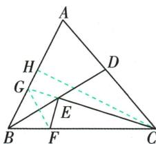
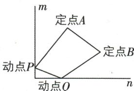

> [!success]- 必刷题
>
> > [!success] **【答案】** B
>
> > [!note]- **【解析】**
> > 如图,作点 F 关于直线 BD 的对称
> >
> > 点 G, 连接 CG, 交 BD 于 E, 作 $CH \perp AB$ 于 H. 由轴对称的性质易得 $CE + EF = CG$ . 因为 BD 平分 $\angle ABC$ , 所以点 G 在 AB 上, 所以
> >
> > 
> >
> > 关键点拨
> > 作点 F 关于 BD 的对称点 G, 连接 CG, 交 BD 于 E, 作 CH ⊥ AB 于 H, 可得出 CE + EF = CG ≥ CH, 进一步利用面积公式得出结果.
> >
> > $CG \geqslant CH$ , 所以 $CE + EF$ 的最小值为 CH 的长.
> > 因为 $\frac{1}{2}AB\cdot CH=18$ ，所以 $\frac{1}{2}\times6CH=18$ ，所以
> > CH=6,所以CE+EF的最小值为6.故选B.
> >
> > 大招解读 | 两定两动
> > 条件:如图,点A,B为定点,点Q在直线n上运动,点P在直线m上运动,求四边形APQB周长的最小值.
> >
> > 
> >
> > 方法:作点 A 关于直线 m 的对称点 $A_{1}$ ，作点 B 关于直线 n 的对称点 $B_{1}$ ，连接 $A_{1}B_{1}, A_{1}B_{1}$ 与直线 m 的交点即为点 P，与直线 n 的交点即为点 Q，此时四边形 APQB 的周长最小，最小为 $AB + AP + PQ + BQ = AB + A_{1}P + PQ + B_{1}Q = AB + A_{1}B_{1}$ .
