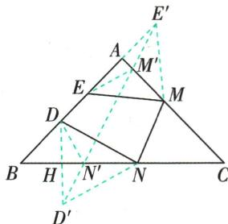
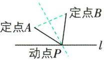
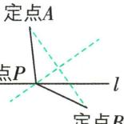
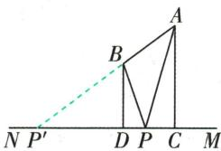

> [!success]- 必刷题
>
> > [!success] **【答案】** B
>
> > [!note]- **【解析】**
> > 如图,作点 D 关于直线 BC 的对称点 $D'$ ,作点 E 关于直线 AC 的对称点 $E'$ ,连接 $D'E'$ 分别交 AC,BC 于点 $M',N'$ ,连接 $ME'$ , $ND',EM',DN'$ .由轴对称的性质可得 $ME = ME',ND = ND'$ ,所以四边形 DEMN 的周长为 $DE + ME + MN + ND = DE + ME' + MN + ND' \geqslant DE + D'E'$ .因为 DE 的长固定,所以当点 M 与点 $M'$ 重合,点 N 与点 $N'$ 重合时,四边形 DEMN 的周长最小,此时 $\angle DNM + \angle EMN = \angle DN'M' +$
> >
> > 关键点拨
> > 能用一条线段表示出三条线段的和的最小值,并确定值最小时点 M, N 的位置是解题的关键.
> >
> > $\angle EM'N'$ . 由对称性、三角形内角和及平角的性质可知 $\angle DN'M' = 180^{\circ} - \angle DN'D' = \angle N'DD' + \angle N'D'D = 2\angle N'D'D, \angle EM'N' = 180^{\circ} - \angle EM'E' = \angle M'EE' + \angle M'E'E = 2\angle M'E'E$ ，所以 $\angle DN'M' + \angle EM'N' = 2\angle N'D'D + 2\angle M'E'E = 2(180^{\circ} - \angle D'DE')$ . 设 $DD'$ 与 BC 交于点 H. 因为 AB = AC, $\angle BAC = 90^{\circ}$ , 所以易得 $\angle BDH = 45^{\circ}$ , 所以 $\angle D'DE' = 180^{\circ} - 45^{\circ} = 135^{\circ}$ , 所以 $\angle DN'M' + \angle EM'N' = 2(180^{\circ} - 135^{\circ}) = 90^{\circ}$ , 即当四边形 DEMN 的周长最小时， $\angle DNM + \angle EMN$ 的度数是 $90^{\circ}$ , 故选 B.
> >
> > 
> >
> > ## 大招解读 | 线段差最值问题
> >
> > <table><tr><td>同侧: </td><td rowspan="2">因为绝对值的最小值为0,所以当PA=PB时,|PA-PB|最小,所以作线段AB的垂直平分线交l于点P,此时PA=PB</td></tr><tr><td>异侧: 动点A l动点P 点B </td></tr></table>
> >
> > 6.5 【解析】如图,延长AB交MN于点P'. 因为
> >
> > $P'A-P'B=AB, AB \geqslant |PA-PB|$ ，所以当点 P 运动到点 $P'$ 的位置时， $|PA-PB|$ 的值最大。因为 AB=5，所以 $|PA-PB|$ 的最大值为 5。故答案为 5。
> >
> > 
> > 全章综合训练
> >
> > 过点 A 作 $AF \parallel l$ ，则 $AF \parallel m$ ，根据平行线的性质得出 $\angle BAF = \angle ABE, \angle ACD = \angle CAF$ ，根据等边三角形的性质得出 $\angle BAC = 60^{\circ}$ ，即可求出 $\angle ACD$ 的度数.
> >
> > 
