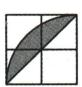
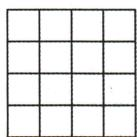

<!-- question-source:start -->
2[2025 湖南长沙质检]已知网格中每个小正方形的边长都是1,图(1)中的阴影图案是由四个小正方形组成的大正方形的一条对角线和以其中一个小正方形顶点为圆心、2为半径所画的圆弧围成的弓形.请你在图(2)中以图(1)为基本图案,借助轴对称和平移设计一个图案,使该图案为轴对称图形.

图(1)

图(2)
<!-- question-source:end -->

![[Q00104308A1]]
