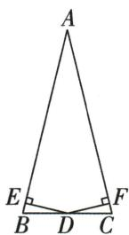
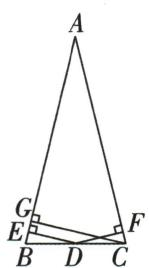
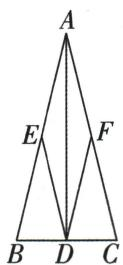
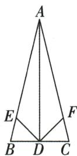

<!-- question-source:start -->
3[2025 山西吕梁期中]问题情境：

数学活动课上,老师提出了一个问题:等腰三角形底边中点到两腰的距离相等吗?同学们就这个问题展开探究.

问题初探:

(1)希望小组的同学们根据题意画出了相应的图形,如图(1),在 $\triangle ABC$ 中, $AB=AC,D$ 是 $BC$ 的中点, $DE\perp AB,DF\perp AC$ ,垂足分别为点 $E,F$ .经过探究讨论,该小组的同学们得出的结论是 $DE=DF$ ,他们的证法如下:

证明：∵ $DE \perp AB, DF \perp AC, \therefore \angle DEB = \angle DFC = 90^{\circ}.$ ∵ AB = AC, ∴ $\angle B = \angle C$ (依据 1). ∵ D 是 BC 的中点, ∴ BD = CD. 在 $\triangle BDE$ 和 $\triangle CDF$ 中,

建议用时 15 分钟 答案 D49

$\angle DEB = \angle DFC,$ $\angle B = \angle C,\quad \therefore \triangle BDE\cong \triangle CDF$ （依据2）， $BD = CD,$ $\therefore DE = DF.$

①请写出依据 1 和依据 2 的内容:

依据 1: \_\_\_\_.

依据 2: \_\_\_\_.

②请你写出另一种证法.

问题再探：

(2) 未来小组的同学们经过探究又有新的发现, 如图 (2), 在 $\triangle ABC$ 中, $D$ 是 $BC$ 的中点, $DE \perp AB, DF \perp AC$ , 垂足分别为 $E, F$ , 作腰 $AB$ 上的高 $CG$ , 则 $CG$ 与 $DE$ 有确定的数量关系. 请你直接写出这个数量关系: \_\_\_\_.

类比探究：

(3)奋斗小组的同学们认真研究过后,发现了以下两个正确结论:①如图(3),在 $\triangle ABC$ 中, $AB=AC,D$ 为 $BC$ 的中点,若 $DE,DF$ 分别为 $\triangle ABD$ 和 $\triangle ACD$ 的中线,那么 $DE=DF$ 仍然成立;②如图(4),在 $\triangle ABC$ 中, $AB=AC,D$ 为 $BC$ 的中点,若 $DE,DF$ 分别为 $\triangle ABD$ 和 $\triangle ACD$ 的角平分线,那么 $DE=DF$ 仍然成立.请你选择其中一个结论证明.

图(1)

图(2)

图(3)

图(4)
<!-- question-source:end -->

![[Q00104309A1]]
