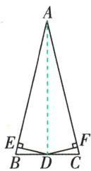
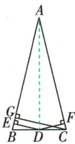

> [!success]- 必刷题
>
> > [!success] **【答案】** 等腰三角形的两个底角相等(或等边对等角),两角分别相等且其中一组等角的对边相等的两个三角形全等(或角角边或AAS)
>
> > [!note]- **【解析】**
> > (1)【解】①依据1:等腰三角形的两个底角相等(或等边对等角).
> > 依据2:两角分别相等且其中一组等角的对边相等的两个三角形全等(或角角边或AAS).
> > 故答案为等腰三角形的两个底角相等(或等边对等角),两角分别相等且其中一组等角的对边相等的两个三角形全等(或角角边或AAS).
> > - **②**：另一种证法如下: 如图(1), 连接 AD.
> > ∵ AB = AC, D 是 BC 的中点, ∴ AD 是 ∠BAC 的平分线. ∵ DE ⊥ AB, DF ⊥ AC, ∴ DE = DF. (证法不唯一)
> >
> > 
> >
> > 
> > 图(1)
> > 图(2)
> >
> > (2)【解】如图(2)，连接 $AD$ ∵ $AB = AC, D$ 是 $BC$ 的中点，∴ $AD$ 是 $\angle BAC$ 的平分线. ∵ $DE \perp AB, DF \perp AC, \therefore DE = DF$ . ∵ $S_{\triangle ABC} = S_{\triangle ABD} + S_{\triangle ACD}, \therefore \frac{1}{2} \times AB \times CG = \frac{1}{2} \times AB \times DE + \frac{1}{2} \times AC \times DF, \therefore CG = 2DE$ ，故答案为 $CG = 2DE$ .
> >
> > (3)【证明】(任选一个证明即可)选择①:
> > ∵ DE, DF 分别是 △ABD 和 △ACD 的中线,
> > ∴ $BE = \frac{1}{2} AB$ , $CF = \frac{1}{2} AC$ . ∵ AB = AC, ∴ BE =
> > CF, ∠B = ∠C. 又∵ D 是 BC 的中点, ∴ BD =
> > CD. 在△BDE 与△CDF 中, $\left\{\begin{aligned}BE&=CF,\\ \angle B&=\angle C,\\ BD&=CD,\end{aligned}\right.$ ∴ $\triangle BDE \cong \triangle CDF(SAS)$ , ∴ DE = DF.
> > 选择②:∵ AB = AC, D 是 BC 的中点, ∴ $\angle B = \angle C$ , BD = CD, AD ⊥ BC, ∴ $\angle ADB = \angle ADC = 90^{\circ}$ . 又∵ DE, DF 分别是 △ABD 和 △ACD 的角平分线, ∴ $\angle BDE = \angle CDF = 45^{\circ}$ . 在 △BDE
> > 与 △CDF 中, $\left\{\begin{aligned}\angle B &= \angle C,\\ BD &= CD,\\ \angle BDE &= \angle CDF,\end{aligned}\right.$ ∴ $\triangle BDE \cong \triangle CDF(ASA)$ , ∴ DE = DF.
