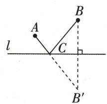
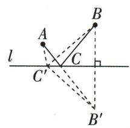
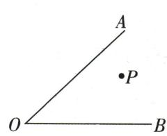

## 数学活动

电子错题本鸭

## 活动

## 活动 1 美术字与轴对称

![[初中/课堂同步/教辅/必刷题/2026版《初中必刷题》数学 RJ  8上/15_第十五章_轴对称/数学活动/questions/Q00104307.md]]

## 活动 2 利用轴对称设计图案

![[初中/课堂同步/教辅/必刷题/2026版《初中必刷题》数学 RJ  8上/15_第十五章_轴对称/数学活动/questions/Q00104308.md]]

## 活动 3 等腰三角形中相等的线段

![[初中/课堂同步/教辅/必刷题/2026版《初中必刷题》数学 RJ  8上/15_第十五章_轴对称/数学活动/questions/Q00104309.md]]

## 实践

建议用时 30 分钟 答案 D49

## [2025 江苏盐城质检]综合与实践

【提出问题】唐朝诗人李颀的诗《古从军行》中“白日登山望烽火，黄昏饮马傍交河”里隐含着一个有趣的数学问题——将军饮马。如图(1)，将军从山脚下的点A出发，到一条笔直的河边l饮马后再回到点B宿营，他时常想，怎么走才能使他每天走的路程之和最短呢？

## 【分析问题】

小亮:如图(2),作 B 关于 l 的对称点 $B'$ , 连接 $AB'$ 与 l 交于点 C, 点 C 就是饮马的地方, 此时按路线 AC-CB 走的路程就是最短的.

小慧:你能详细解释原因吗?

图(1)

图(2)

图(3)

图(4)

小亮:如图(3),在 l 上另取一点 $C'$ , 连接 $AC', BC', B'C'$ , 只要证明 $AC + CB < AC' + C'B$ 即可. 请写出小亮的证明过程.
