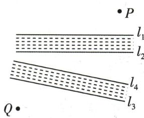

## 综合与实践 最短路径问题

任务一:如图(4),将军牵马从军营P处出发,先到河边OA饮马,再到草地OB牧马,最后回到P处,试分别在OA和OB上各找一点E,F,使得将军走过的路程最短.(保留画图痕迹,辅助线用虚线,最短路径用实线)

任务二:如图(5)所示,在P,Q两村之间有两条河,且每条河的宽度处处相等,从P村前往Q村,要经过这两条河.现在要在这两条河上分别造一座垂直于河岸的桥EF,MN,则这两座桥EF,MN造在何处可使由P村到Q村的路程最短?(要求在图上标出道路和大桥的位置)

图(5)

建议用时-35分钟 答案-D50

难关
