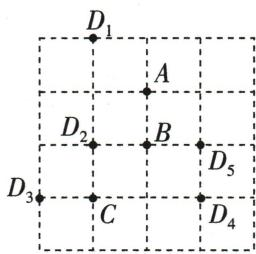

<!-- question-source:start -->
2[2025 浙江杭州期末]如图,点 A,B,C 和点 $D_{1}$ , $D_{2}$ , $D_{3}$ , $D_{4}$ , $D_{5}$ 都在正方形网格的格点上,则能与点 A,B,C 组成轴对称图形的 D 点有 \_\_\_\_ 个.

<!-- question-source:end -->

![[Q00104238A1]]
