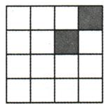
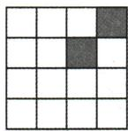
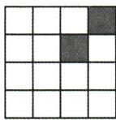
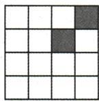

<!-- question-source:start -->
3[2025 江苏扬州期中]如图,在图(1)中选2个小正方形涂阴影,在图(2)、(3)、(4)中分别选3个小正方形涂阴影(用不同方法),分别使它们与图中的2个阴影小正方形组成的图形为轴对称图形.

图(1)

图(2)

图(3)

图(4)
<!-- question-source:end -->

![[Q00104239A1]]
