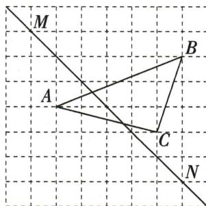

<!-- question-source:start -->
6 如图, 方格图中每个小正方形的边长为 1, 点 A, B, C, M, N 都在格点上.
(1)画出 $\triangle ABC$ 关于直线MN对称的 $\triangle A_{1}B_{1}C_{1}$ .
(2) 在直线 MN 上找点 P，使 $\left|PB-PA\right|$ 最大，在图形上画出点 P 的位置，并直接写出 $\left|PB-PA\right|$ 的最大值.

<!-- question-source:end -->

![[Q00104242A1]]
